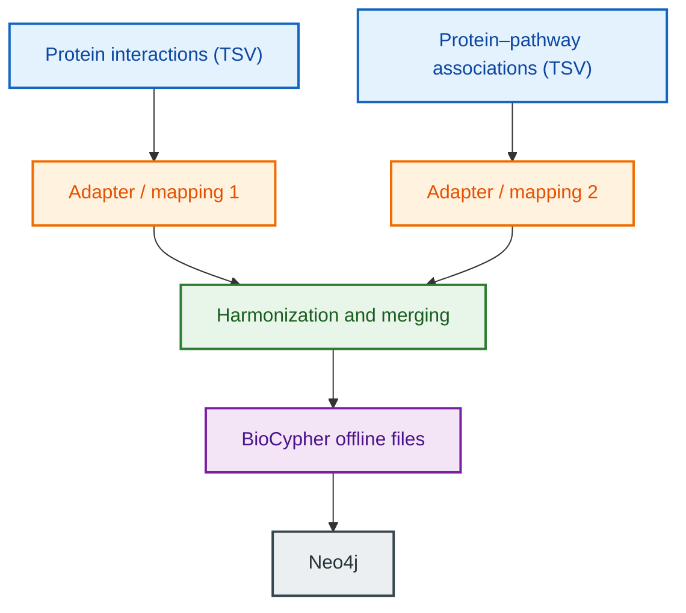
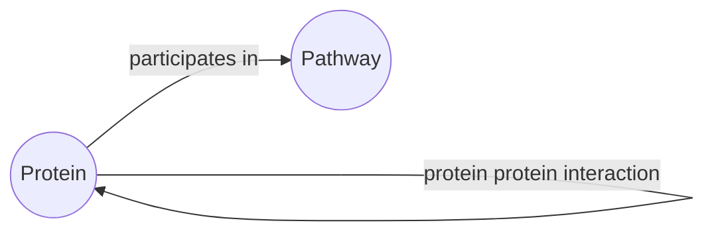

---
tags:
  - tutorial
  - advanced
---

# Hands-on Data Harmonization and Merging with BioCypher, OntoWeaver and Neo4j

**Level:** Advanced (Python UI and OntoWeaver tracks)  
**Who is this for?** Users who have completed one of the beginner tutorials and need to combine data from multiple heterogeneous, partly inconsistent sources into one knowledge graph.  
**What you will do:** Extend the protein interaction graph with a protein–pathway dataset, identify data-quality issues across the two sources, harmonize and merge them either with a Python adapter or with an OntoWeaver mapping, and import and query the combined graph in Neo4j.  
**Estimated time:** 90–120 minutes.  

<!-- TODO: confirm estimated time once the content is complete. -->


## Overview

This tutorial builds on the knowledge graph from the beginner tutorials ([Python UI](../tutorial_basics_neo4j_offline/tutorial_004_neo4j_offline.md), [LLM-assisted UI](../tutorial_basic_with_agents/tutorial_basic_with_agents.md) and [OntoWeaver](../tutorial_ontoweaver/tutorial_ontoweaver.md)). You will add a second data source, a synthetic dataset of protein–pathway associations, and learn how to reconcile entities and properties that appear in both sources into a single, coherent graph.

Real-world sources rarely agree with each other: the same protein can be spelled differently, mapped to conflicting gene symbols or taxa, or appear in malformed records. By default, **BioCypher does not reconcile data**: when two identical entities carry different properties, BioCypher keeps the first set of properties it encounters. Harmonization therefore has to happen *before* the data reaches BioCypher, either in your own Python adapter code or through the reconciliation mechanisms of OntoWeaver.

By the end of this tutorial, you will be able to:

- Extend an existing graph model with a new node and edge type.
- Identify typical data-quality issues when merging multiple sources.
- Choose a strategy for deduplication and conflicting property resolution.
- Combine multiple adapters (or mappings) into one knowledge graph.
- Compare a Python code adapter with an OntoWeaver low-code adapter in terms of extensibility.
- View and query the merged graph using Neo4j.

The workflow in this tutorial is:



Throughout the tutorial, you can follow one of two implementation paths. Code blocks are shown in tabs so that you can switch between them:

- **Python adapter:** separate Python adapter modules for each source; harmonization logic is written in Python. Reference implementation: [python-ui-adapter-extended](https://github.com/iulusoy/python-ui-adapter-extended).
- **OntoWeaver:** a separate declarative mapping for each source; OntoWeaver's built-in reconciliation mechanisms are extended with custom transformers where needed. Reference implementation: [ontoweaver-adapter-extended](https://github.com/ecarrenolozano/ontoweaver-adapter-extended).


## Pre-requisites

> **Note:** Ensure you have the following prerequisites before continue with the tutorial.

| Tool               | Version/Requirement | Installation Link                                                  | Notes                                  |
| ------------------ | ------------------- | ------------------------------------------------------------------ | -------------------------------------- |
| Git                | Any                 | [Git Docs](https://git-scm.com/downloads)                          | For version control                    |
| Neo4j              | >=1.6               | [Neo4j Desktop](https://neo4j.com/download/)                       | For querying graphs                    |
| uv                 | >=0.7.x             | [uv Docs](https://docs.astral.sh/uv/getting-started/installation/) | For dependency management              |
| Python             | >= 3.12             | [Python.org](https://www.python.org/downloads/)                    | Required for BioCypher and OntoWeaver  |
| Jupyter (optional) | Any                 | [Jupter](https://jupyter.org/)                                     | Required for exploring the sample data |

You should also be familiar with the content of at least one of the beginner tutorials, since this tutorial reuses the protein interaction dataset, schema and Neo4j setup from there.

!!! warning "BioCypher version pin"
    OntoWeaver currently pins `biocypher<0.17.0,>=0.11.0`. If you follow the OntoWeaver path,
    use a dedicated environment for this tutorial until OntoWeaver's pin is relaxed.

## Setup

### Setup Python project

In this section, you will set up your working environment.

<!-- TODO: decide whether learners start from the result of the beginner tutorial or clone the reference repositories. -->

=== "Python adapter"

    1. Start from your repository of the [Python UI tutorial](../tutorial_basics_neo4j_offline/tutorial_004_neo4j_offline.md), or clone the reference implementation:

        ```bash
        git clone https://github.com/iulusoy/python-ui-adapter-extended.git
        cd python-ui-adapter-extended
        ```

    2. Install the dependencies:

        ```bash
        uv sync
        ```

=== "OntoWeaver"

    1. Start from your repository of the [OntoWeaver tutorial](../tutorial_ontoweaver/tutorial_ontoweaver.md), or clone the reference implementation:

        ```bash
        git clone https://github.com/ecarrenolozano/ontoweaver-adapter-extended.git
        cd ontoweaver-adapter-extended
        ```

    2. Install the dependencies:

        ```bash
        uv venv
        uv pip install -r requirements.txt
        ```

### Setup Neo4j

Use the Neo4j instance you created in one of the beginner tutorials, or create a new one following the steps in [Setup Neo4j](../tutorial_basics_neo4j_offline/tutorial_004_neo4j_offline.md#setup-neo4j). Keep the path to your Neo4j instance at hand, you will need it later in this tutorial.


## Section 1. Exploratory Data Analysis

In addition to the [protein interaction dataset](https://zenodo.org/records/16902349) from the beginner tutorials, we use a synthetic dataset of protein–pathway associations, `synthetic_reactome_protein_pathway.tsv`.

<!-- TODO: add the Zenodo link of the protein–pathway dataset (Carreño 2026) and the download command. -->

- First, download the dataset:

    ```bash
    # TODO: add download command
    ```

- Inspect the columns of the dataset:

    | Column | Description |
    | --- | --- |
    | `uniprot_id` | UniProt accession of the protein |
    | `gene_symbol` | Gene symbol of the protein |
    | `ncbi_tax_id` | NCBI taxonomy identifier |
    | `entity_type_source` | Entity type of the source |
    | `pathway_id` | Reactome-like pathway identifier |
    | `pathway_name` | Name of the pathway |
    | `pathway_description` | Description of the pathway |
    | `relationship_type` | Type of the protein–pathway relationship |
    | `evidence_code` | Evidence code for the association |
    | `source_database` | Database the association originates from |
    | `is_synthetic` | Flag marking synthetic records |

<!-- TODO: add pandas code to load and explore the dataset, as in the beginner tutorials. -->

### Data inconsistencies

The protein–pathway dataset contains deliberately introduced inconsistencies, both within the file and with respect to the protein interaction dataset:

| Category | Finding | Rows |
| --- | --- | --- |
| Schema conformance | Malformed record: 10 fields instead of 11, causing a column shift. | 18 |
| Completeness | Missing value in `is_synthetic` caused by the malformed record. | 18 |
| Domain validity | Values violate expected domains, e.g. non-numeric `ncbi_tax_id`, invalid `pathway_id`, invalid controlled values. | 18 |
| Format standardization | Inconsistent gene-symbol casing: `EGFR`/`egFr`, `MYC`/`myc`. | 2–5 |
| Entity consistency | Same `uniprot_id` maps to conflicting gene symbols, e.g. `P04637`: `SOD1`/`TP53`. | 7–9 |
| Referential consistency | Same `uniprot_id` appears with conflicting taxon IDs, e.g. `P00533`: `9606`/`10090`. | 2–3 |

### Exercise 1. Find the inconsistencies

<!-- TODO: write an exercise where learners detect the inconsistencies above with pandas, with a collapsible solution. -->


## Section 2. Graph Modeling

### Extending the graph model

The knowledge graph model from the beginner tutorials is extended with the node type `pathway` and the relationship `participates in`, which links proteins to the biological pathways in which they are involved.



<!-- TODO: replace with a figure of the extended graph model (case2_kg-model) and list node/edge properties. -->

**Pathway properties**

<!-- TODO: list pathway properties (pathway_name, pathway_description, source_database, is_synthetic). -->

**Participates in properties**

<!-- TODO: list edge properties (evidence_code, source_database, is_synthetic / relationship_type). -->

### Exercise 2. Example of a merged graph we expect with our data

<!-- TODO: small mermaid example showing a protein that appears in both sources, merged into a single node. -->


## Section 3. Harmonization strategies

Before writing any code, decide how each type of inconsistency should be handled. This section introduces the main strategies.

### Deduplication

<!-- TODO: explain how identical entities from different sources are identified (e.g. by uniprot_id) and merged into one node. -->

### Conflicting property resolution

<!-- TODO: explain BioCypher's default behavior (first set of properties wins) and strategies to resolve conflicts: source priority, normalization, keeping raw values (e.g. raw_genesymbol), annotating conflicts (e.g. data_quality_note). -->

### Format standardization

<!-- TODO: e.g. upper-casing gene symbols. -->

### Handling malformed and invalid records

<!-- TODO: dropping vs. repairing records, validating domains (taxon IDs, pathway IDs, controlled vocabularies), logging. -->


## Section 4. Graph creation from multiple sources

We aim to create one knowledge graph from both datasets. We can divide the process into the following steps:

1. [Configuration](#step-1-configuration).
    - [Extend the schema](#extend-the-schema-for-your-graph)
    - [BioCypher configuration](#configure-biocypher-behavior)
2. [Create an adapter or mapping for the new source](#step-2-create-an-adapter-or-mapping-for-the-new-source).
3. [Implement the harmonization logic](#step-3-implement-the-harmonization-logic).
4. [Combine the sources and create the knowledge graph](#step-4-combine-the-sources-and-create-the-knowledge-graph).
5. [Test the merged graph](#step-5-test-the-merged-graph).

### Step 1. Configuration

#### Extend the schema for your graph

**Rationale:** the schema needs to know about the new node type `pathway` and the new edge type `participates in`.

=== "Python adapter"

    ```yaml title="config/schema_config.yaml (excerpt)"
    pathway:
        represented_as: node
        namespace: reactome
        input_label: reactome_pathway

    participates_in:
        is_a: association
        represented_as: edge
        source: protein
        target: pathway
        input_label: participates_in
        properties:
            evidence_code: str
            source_database: str
            is_synthetic: bool
    ```

=== "OntoWeaver"

    ```yaml title="config/schema_config.yaml (excerpt)"
    pathway:
        represented_as: node
        preferred_id: reactome
        input_label: pathway
        properties:
            pathway_name: str
            pathway_description: str
            source_database: str
            is_synthetic: str

    protein participates in pathway:
        is_a: participates in
        represented_as: edge
        input_label: protein_participates_in_pathway
    ```

<!-- TODO: explain the differences between the two schemas and the Biolink classes used. -->

#### Configure BioCypher behavior

<!-- TODO: note any changes to biocypher_config.yaml compared to the beginner tutorials. -->

### Step 2. Create an adapter or mapping for the new source

**Rationale:** each source dataset gets its own adapter module (Python) or declarative mapping (OntoWeaver). This keeps source-specific logic separated and makes it easy to add further sources later.

=== "Python adapter"

    <!-- TODO: walk through src/adapters/adapter_synthetic_pathways.py: node and edge types, fields, get_nodes() and get_edges(). -->

=== "OntoWeaver"

    <!-- TODO: walk through config/protein_pathway_mapping.yaml: row mapping, transformers, to_object / to_property, metadata. -->

### Step 3. Implement the harmonization logic

**Rationale:** BioCypher does not reconcile data. Inconsistencies must be resolved before nodes and edges are passed to BioCypher.

=== "Python adapter"

    <!-- TODO: show the transformation and reconciliation code in the adapters for each inconsistency category. -->

=== "OntoWeaver"

    <!-- TODO: show OntoWeaver's built-in reconciliation and the custom transformer in adapter_transformers.py (reconcile_pathway_field) for malformed records. -->

### Step 4. Combine the sources and create the knowledge graph

**Rationale:** the nodes and edges from both sources are passed to BioCypher to construct the combined knowledge graph.

=== "Python adapter"

    ```python title="create_knowledge_graph.py (excerpt)"
    # Create a knowledge graph from both adapters.
    for adapter in (protein_adapter, pathway_adapter):
        bc.write_nodes(adapter.get_nodes())
        bc.write_edges(adapter.get_edges())

    # Generate assets for Neo4j exportation
    bc.write_import_call()
    ```

    <!-- TODO: full script and how to run it. -->

=== "OntoWeaver"

    <!-- TODO: ontoweave command with both mappings, e.g. data file and mapping pairs. -->

### Step 5. Test the merged graph

**Rationale:** tests make sure that the harmonization rules are applied and that the two sources are merged consistently.

<!-- TODO: describe the test suites of both reference implementations (per-adapter tests vs. cross-file integrity and noisy reconciliation tests). -->


## Section 5. Comparing the two approaches

Both implementations produce the same extended graph, but differ in how much code is needed and where the harmonization logic lives. The plain Python adapter requires additional code for data transformation and reconciliation. OntoWeaver uses an additional mapping file and built-in reconciliation mechanisms; however, malformed records and source-specific inconsistencies may still require custom transformers.

|                               | Python adapter                  | OntoWeaver                 |
| ----------------------------- | ------------------------------- | -------------------------- |
| Repository structure          | `config`, `data`, `src`         | `config`, `data`           |
| Number of configuration files | 2                               | 3                          |
| Number of source files        | 2                               | 1                          |
| Source Python LOC             | ≈ 440                           | 100                        |
| Number of test files          | 2                               | 3                          |
| Test Python LOC               | ≈ 300                           | ≈ 248                      |
| Dependency handling           | `pyproject.toml`                | `requirements.txt`         |

<!-- TODO: discuss when to choose which approach. -->


## Section 6. Interacting with your graph using Neo4j

### Load the graph using an import script

<!-- TODO: refer to / adapt the import steps from the beginner tutorials. -->

### Visualize the graph

<!-- TODO: screenshot of the merged graph with protein and pathway nodes. -->

### Execute cypher queries

<!-- TODO: queries that verify the harmonization, e.g. proteins participating in a pathway, proteins present in both sources, absence of duplicated proteins. -->

---

## Next Steps
- Add a third data source to your graph and reuse the harmonization strategies from this tutorial.
- See [Handling Ontologies](../tutorial002_handling_ontologies.md) for synonyms and hybrid ontologies.
- See the [Adapters explanation](../../explanation/adapters.md) for background on combining multiple adapters into one pipeline.

## Feedback & Contributions

If you found this tutorial helpful or have suggestions for improvement, please **open an issue** or **submit a pull request** in the [BioCypher repository](https://github.com/biocypher/biocypher/issues/new/choose). Specific feedback on examples, clarity of instructions, or missing details is especially appreciated.

---

| Last Update | Developed by                                                | Affiliation                                                         |
| :---------: | :---------------------------------------------------------- | ------------------------------------------------------------------- |
| 2026.10.14  | Inga Ulusoy (GH @iulusoy) <br> Edwin Carreño (GH @ecarrenolozano) | [Scientific Software Center](https://www.ssc.uni-heidelberg.de/en) <br> [Scientific Software Center](https://www.ssc.uni-heidelberg.de/en) |


## Summary

In this tutorial, you:

- extended the graph model with pathways,
- identified inconsistencies across two data sources,
- chose harmonization strategies,
- created an adapter or mapping for the new source,
- merged both sources into one knowledge graph,
- compared a Python adapter with an OntoWeaver adapter,
- imported the graph into Neo4j,
- queried the merged graph.
